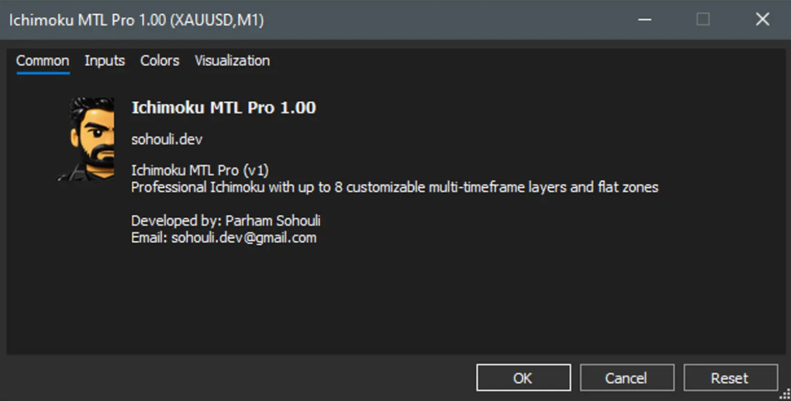

# Ichimoku MTL Pro (v1.00)

Professional Ichimoku indicator for **MetaTrader 5** with up to **8 independent multi-timeframe layers**, flat-level detection, and live distance and bar-countdown panels.



> **Developed by:** Parham Sohouli (sohouli.dev)
> **Build tested with:** MT5 build `____` (fill in before release)
> **Distribution:** Compiled `.ex5` only (source is not published). Free to use under the [licence](LICENSE).
> **Status:** Report bugs in Issues.

---

## Table of contents

1. [Features](#features)
2. [Installation](#installation)
3. [Quick start](#quick-start)
4. [Interface guide](#interface-guide)
5. [Layers](#layers)
6. [Lines and cloud](#lines-and-cloud)
7. [Flat levels](#flat-levels)
8. [Distance panel (Dist)](#distance-panel-dist)
9. [Time panel (Time)](#time-panel-time)
10. [Colour changes](#colour-changes)
11. [Inputs reference](#inputs-reference)
12. [Multiple instances](#multiple-instances)
13. [Saved state](#saved-state)
14. [Known limitations](#known-limitations)
15. [Troubleshooting](#troubleshooting)
16. [FAQ](#faq)
17. [Licence](#licence)

---

## Features

- **Up to 8 layers.** Each layer has its own timeframe, so you can view M1, M5, H1, D1 or any other TF on one chart.
- **Five Ichimoku lines per layer:** Tenkan-sen, Kijun-sen, Senkou Span A, Senkou Span B, and Chikou Span, with a coloured cloud (Kumo).
- **Per-layer toggle buttons.** Show or hide each line of each layer with one click.
- **Dynamic layers.** Add (`+`) or remove (`-`) layers at runtime, up to 8.
- **Colour stripe** under each line button, so you can see each line's colour at a glance.
- **Colours editable from Properties** and applied without reloading the indicator.
- **Flat-level detection** on each layer's timeframe, drawn as horizontal zones.
- **Distance panel:** distance from price to the Kijun of each layer in pips and ATR, with an alert colour.
- **Time panel:** countdown to the close of the current bar on each layer's timeframe.
- **Draggable panels.** The Dist and Time buttons and their labels can be moved; their positions are saved.
- **No look-ahead on higher timeframes.** Higher-TF values use the last closed bar by default, so the indicator does not repaint on those layers.
- **State is saved** between chart reloads (layer count, TF, button states, flat rules, and panel positions).

---

## Installation

1. Go to the **Releases** page of this repository and download `Ichimoku MTL Pro.ex5`.
2. In MT5, choose **File → Open Data Folder**.
3. Copy the `.ex5` file into:
   ```
   MQL5\Indicators\
   ```
4. In MT5, open the **Navigator** (`Ctrl+N`), right-click **Indicators**, and choose **Refresh**.
5. Drag **Ichimoku MTL Pro** onto a chart.

> Only the compiled file is provided. The source code is not published.

---

## Quick start

1. Attach the indicator to a chart (for example, XAUUSD M1).
2. Layer 1 is created on the chart timeframe. Use its **TF** button to change its timeframe (for example, to H1).
3. Press **+** to add layer 2, and set its timeframe (for example, D1).
4. Click a line button (for example `T`, `K`, `SA`) to hide or show that line.
5. Open **Properties → Colors** to change line colours. Changes apply immediately.
6. Use the **Dist** and **Time** buttons at the bottom right to show the distance and countdown panels.

---

## Interface guide

Each layer is one row of buttons, starting at the top-left of the chart:

```
[All] [TF] [T] [K] [SA] [SB] [CL] [CH] [+] [-]
```

| Button | Meaning |
|---|---|
| **All** | Show or hide all lines of this layer. |
| **TF** | Open the timeframe menu for this layer (M1 … MN). |
| **T** | Tenkan-sen (conversion line). |
| **K** | Kijun-sen (base line). |
| **SA** | Senkou Span A (leading span A). |
| **SB** | Senkou Span B (leading span B). |
| **CL** | Cloud (Kumo), filled between SA and SB. |
| **CH** | Chikou Span (lagging line). |
| **+** | Add a new layer (max 8). |
| **-** | Remove the last layer. |

A thin coloured stripe appears under each line button. Its colour matches the line.

Below the layer rows, the **+ Flat** button opens the flat-rule panel. The **Dist** and **Time** buttons are at the bottom right and can be dragged.

---

## Layers

- Each layer has an independent **timeframe**. Choose it from the **TF** menu.
- Layer TFs can be lower or higher than the chart TF.
- **Plot shift.** Senkou and Chikou are shifted by the Kijun period, scaled to the layer's timeframe, to match standard Ichimoku display.
- **Higher TF calculation.** Values are computed from High, Low and Close of that timeframe. With `InpMTFUseClosedBar = true` (default), only closed bars are used, so the values do not change within a bar.
- **Removing a layer** hides it and frees its slot. Its line buttons and flats are removed too.
- The maximum number of layers is **8**.

---

## Lines and cloud

- **Tenkan (9)**, **Kijun (26)**, **Senkou B (52)** are the default periods (`InpTenkan`, `InpKijun`, `InpSenkou`).
- The **cloud** is drawn between Senkou A and Senkou B. Bullish (A above B) and bearish (A below B) colours are separate.
- **Cloud transparency** is set by `InpCloudTransparencyPercent`. MetaTrader does not support true transparency on filled plots, so the indicator approximates it by blending the cloud colour with the chart background. This is an approximation, not real alpha.

---

## Flat levels

A **flat** is a price level that stays within a small tolerance for at least **N** consecutive closed bars on the layer's timeframe. Flats are useful for spotting support and resistance zones.

### Creating a flat rule

1. Click **+ Flat**.
2. Pick the **Layer** (L1 … L8) in the first dropdown.
3. Pick the **Line** (T, K, SA, SB, CH) in the second dropdown.
4. Enter the **length N** (minimum 2) in the numeric box.
5. Click **flat toggle** to turn the rule on.

### Rule buttons

Each rule row has:

| Button | Action |
|---|---|
| **L** | Change layer. |
| **C** | Change line. |
| **N** | Edit length. |
| **S** | Show or hide the rule. |
| **X** | Delete the rule. |

### How flats are drawn

- The zone spans the actual run of bars that met the condition, not the entered N.
- The level extends to the right as a ray.
- Only the latest `InpFlatMaxLevels` runs are drawn per rule.
- For Senkou lines, the flat is shifted forward by `InpKijun` bars, as with the line itself.

### Limits

- The scan covers the last `InpFlatLookback` closed bars (default 500). A run longer than that window cannot be found.
- `InpMaxFlatRules` sets how many rules can exist (up to 16).

---

## Distance panel (Dist)

Click **Dist** to show or hide it.

For each layer, the panel shows the distance from the current **Bid** to that layer's **Kijun**:

```
L2 M5 Kijun: -1944.5 pips | 4.72 ATR
```

- **Pips.** Pip size is determined automatically (10 points for 3- and 5-digit symbols, otherwise `_Point`). Set `InpPipSize` to override.
- **ATR.** The distance in ATR units uses `InpATRPeriod` on the layer's closed bars.
- **Colour.** Normal colour is `InpDistColor`. When the distance is at or above `InpAlertATR` ATR, the text uses `InpAlertColor`.

---

## Time panel (Time)

Click **Time** to show or hide it.

Each layer shows a countdown to the close of its current bar:

```
L1 M1 -6s
L2 M5 -2m 06s
```

- The countdown uses the **server time** (`TimeTradeServer()`).
- Precision is one second.
- Around weekends and holidays, the countdown may not match the broker's session close exactly.

---

## Colour changes

- Open **Properties → Colors** and change any line colour.
- Changes are written to the chart's plots and applied at the next update, without reloading.
- Each layer has its own colour set, so layers stay distinguishable.

---

## Inputs reference

| Input | Default | Description |
|---|---|---|
| `InpTenkan` | 9 | Tenkan-sen period. |
| `InpKijun` | 26 | Kijun-sen period. Also the Senkou/Chikou shift. |
| `InpSenkou` | 52 | Senkou Span B period. |
| `InpStripeDY` | 0 | Vertical offset of the colour stripe (px). |
| `InpInstanceID` | 0 | Unique ID for this instance (see [Multiple instances](#multiple-instances)). |
| `InpCloudTransparencyPercent` | 40 | Cloud transparency, 0–100 (approximated). |
| `InpMTFUseClosedBar` | true | Use the last closed bar for higher TFs (no repaint). |
| `InpMaxFlatRules` | 8 | Maximum flat rules (1–16). |
| `InpFlatLookback` | 500 | Closed bars scanned for flats. |
| `InpFlatMaxLevels` | 20 | Maximum flat levels drawn per rule. |
| `InpFlatTolPoints` | 0 | Flat tolerance in points. 0 = exact match. |
| `InpATRPeriod` | 14 | ATR period for the distance panel. |
| `InpPipSize` | 0 | Pip size override. 0 = automatic. |
| `InpAlertATR` | 1.5 | Alert threshold (ATR multiples). |
| `InpDistColor` | Gray | Normal distance text colour. |
| `InpAlertColor` | Red | Alert distance text colour. |
| `InpDistX` | 10 | Distance panel X offset (from the bottom-right corner). |
| `InpDistY` | 30 | Distance panel Y offset. |

---

## Multiple instances

You can attach the indicator more than once to the same symbol, but each instance must have a **different `InpInstanceID`** (0, 1, 2 …). Otherwise their objects and saved states will overlap.

---

## Saved state

The indicator stores these values in MT5 Global Variables, keyed by symbol and `InpInstanceID`:

- Number of layers and each layer's TF
- Button states (shown or hidden)
- Flat rules
- Dist and Time panel positions

To reset the saved state, remove the indicator from the chart, then delete the related Global Variables from **Tools → Global Variables** (F3).

---

## Known limitations

- **Cloud transparency** is approximated by colour blending, not true alpha.
- **Flat search** is limited to `InpFlatLookback` bars.
- **Countdown** near weekends or holidays may not match the broker's session.
- **Colour changes** on some plot types may need a chart refresh (`F5`) to appear.
- Large numbers of layers and flat rules increase CPU use. Use fewer layers on slow machines.

---

## Troubleshooting

| Problem | Fix |
|---|---|
| Indicator does not appear in Navigator | Press **Refresh** in the Navigator, or restart MT5. |
| Buttons overlap or are off screen | Drag them, or change `InpDistX` / `InpDistY`. |
| Layer values do not change | Check the layer TF, and that the chart has enough history. |
| Two instances share state | Give each instance a unique `InpInstanceID`. |
| Dist or Time shows nothing | Click the button to toggle it on. |

---

## FAQ

**Does it repaint?**
Higher-TF layers do not repaint when `InpMTFUseClosedBar = true`. The current, unclosed bar of the chart TF moves as usual.

**Can I use it for signals?**
This is an analysis tool. It does not place orders. Test it on a demo account first.

**Why do I see "-" for some layers?**
A layer with a higher TF may have fewer closed bars available at the start of history.

---

## Licence

See [LICENSE](LICENSE). Free to use. Redistribution, reverse engineering and resale without the author's permission are not allowed.

---

## Contact

- Developer: Parham Sohouli
- Website: sohouli.dev
- GitHub: https://gist.github.com/sohouli-dev
